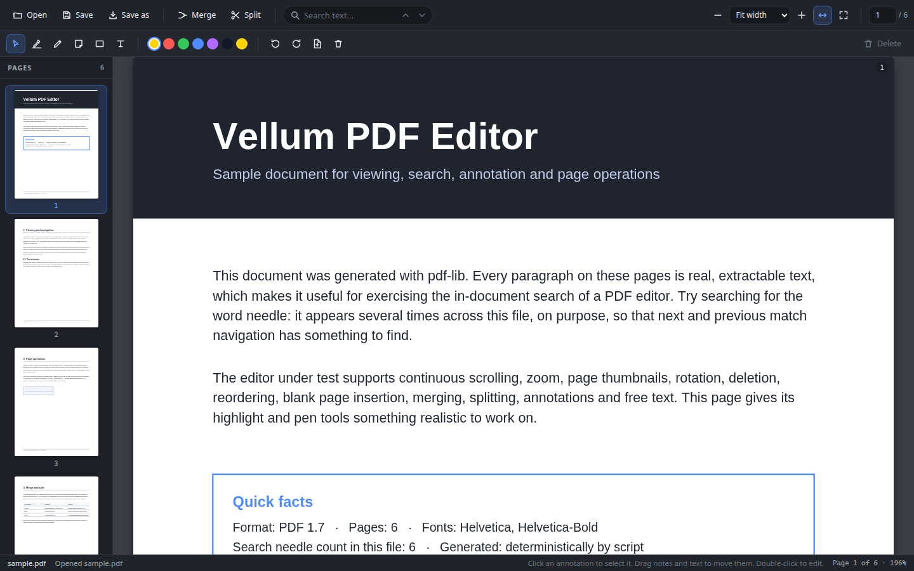

# Vellum PDF Editor

A desktop PDF editor MVP in the spirit of Acrobat and Foxit, built from scratch with
Electron, TypeScript, React and Vite. Rendering is done by pdf.js (`pdfjs-dist`),
document manipulation by `pdf-lib`. The UI is hand-written CSS, no framework.



## Features

- **Open / Save / Save as.** Native file dialogs; saving bakes every change into
  the file. Drag-and-drop a PDF anywhere in the window also works.
- **Reading view.** Continuous vertical scroll, zoom in/out, fit width, fit page,
  preset zoom levels, numeric page navigation, and a thumbnail sidebar that stays
  in sync with the document.
- **Text search.** In-document search with per-word match highlighting on the page,
  match counter, and next/previous navigation (Enter / Shift+Enter) that scrolls
  to the match.
- **Page operations.** Rotate left/right, delete page, insert blank page (inherits
  the current page size), and drag-to-reorder in the thumbnail sidebar.
- **Merge and split.** Append another PDF to the open document; export a page range
  like `1-3, 5` as a new PDF without touching the open one.
- **Annotations.** Highlight, freehand pen, sticky note and rectangle tools with
  color and stroke-width options. Drawn on an SVG overlay while editing and
  flattened into the page content stream on save.
- **Add and edit text.** Click anywhere to place a text box with font-size and
  color options. Existing text boxes can be moved, edited and restyled; they are
  flattened into the PDF on save.
- **Keyboard.** Ctrl/Cmd+O open, Ctrl/Cmd+S save, Ctrl/Cmd+Shift+S save as,
  Ctrl/Cmd+F search, Ctrl/Cmd +/- zoom, Delete removes the selected annotation.

## Requirements

- Node.js 20+
- Linux: an X11/Wayland session for the Electron window (or `xvfb-run` for
  headless runs)

## Setup

```bash
npm install
```

If the Electron binary is missing afterwards (some CI environments skip binary
downloads), run `node node_modules/electron/install.js` once.

## Run

```bash
npm run dev          # Vite dev server + Electron with esbuild watch for main/preload
npm start            # run the production build (after npm run build)
npm start -- path/to/file.pdf   # open a file directly
```

## Build and checks

```bash
npm run typecheck    # strict tsc, main/preload config + renderer config
npm run build        # typecheck + esbuild (main, preload) + vite (renderer)
npm run make-sample  # generate sample/sample.pdf (6 pages, searchable text)
npm run smoke-ops    # Node-level sanity test of every pdf-lib operation used
```

## Verification harnesses

Two headless harnesses prove the app works end to end:

```bash
npm run screenshot       # real Electron window -> artifacts/screenshot.png
npm run screenshot:web   # renderer preview via headless Chrome -> artifacts/
npm run test:e2e         # 23 functional checks driven through the real UI
```

- `screenshot` launches the packaged app, auto-opens the sample PDF and captures
  the window. It needs a display (`xvfb-run` is used automatically when
  `DISPLAY` is unset).
- `screenshot:web` and `test:e2e` use the same built renderer inside headless
  Chrome through the browser platform fallback. `test:e2e` exercises search,
  all five annotation tools, rotate/insert/delete/reorder, merge, split and
  save-with-flatten, then re-parses the downloaded PDFs in Node to confirm the
  flattened content is real, extractable text.

Note: in restricted sandboxes (gVisor-style), Electron's Chromium cannot create
shared memory and the renderer crashes; use the `*:web` harnesses there. On a
normal desktop, `npm run dev` and `npm start` work directly.

## Project layout

```
src/
  main/        Electron main process: window, dialogs, fs IPC, screenshot hook
  preload/     contextBridge exposing the typed window.pdfEditor API
  shared/      IPC channel names and payload types shared by all three sides
  renderer/
    pdfcore/   UI-independent core: pdf.js loading/rendering, text extraction,
               annotation types, coordinate helpers, flatten-to-PDF, EditorStore
    state/     React context binding (useSyncExternalStore)
    components/Toolbar, AnnotationToolBar, Sidebar, PageView, AnnotationLayer,
               SplitDialog, icons
scripts/       dev/build/sample/smoke/screenshot/e2e runners (plain Node)
sample/        generated sample PDF used by the harnesses
```

### How the pieces fit

One document lives in two forms: a pdf.js `PDFDocumentProxy` for rendering and
text extraction, and a pdf-lib `PDFDocument` for manipulation. Every structural
edit (rotate, delete, insert, reorder, merge) mutates the pdf-lib document,
re-serializes it, and reloads the pdf.js side. Pages carry stable internal IDs
so annotations survive reordering. Annotations are stored in PDF user-space
coordinates (bottom-left origin, rotation independent) and converted through
the pdf.js viewport, so they land correctly at any zoom or rotation. On save,
`flatten.ts` redraws them into a fresh copy of the document with pdf-lib.

The preload bridge is the only renderer-to-OS channel (context isolation on,
node integration off). A browser fallback implementation of the same API lets
the renderer run standalone for development and for the headless harnesses.

## Known limitations vs a full Acrobat-class editor

- Flattened text uses the standard Helvetica font (WinAnsi). Non-Latin-1
  characters are replaced with `?` on save; proper Unicode needs embedded TTFs.
- No undo/redo yet, and no multi-page selection for bulk rotate/delete.
- Rectangle, pen and highlight annotations can be deleted and recolored but not
  moved or resized; notes and text boxes are movable.
- Sticky notes flatten as visible marker + text (real popup annotation objects
  are not created).
- Search operates on the extracted text layer; scanned/image-only PDFs have no
  text layer to search.
- Coordinate mapping assumes pages whose MediaBox starts at the origin, which
  covers virtually all office PDFs but not every print-shop file.
- Very large documents (hundreds of pages) work, but thumbnail rendering is
  on-demand only and there is no tile caching beyond pdf.js defaults.
- The window has no native application menu; everything lives in the toolbars.
